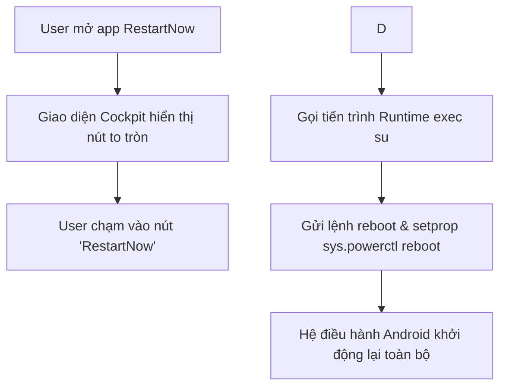

# Đặc Tả Kỹ Thuật (Specification): RestartNow

**Phiên bản:** 1.0  
**Tác giả:** Antigravity Strategy Lead  
**Trạng thái:** Sẵn sàng triển khai  
**Dự án:** Ứng dụng Khởi động lại 1-Chạm cho Màn hình Android Ô tô Ownice C800 Pro  

---

## 1. Tổng Quan (Executive Summary)
RestartNow là ứng dụng tiện ích độc lập dành cho hệ điều hành Android trên ô tô. Ứng dụng chỉ có duy nhất một tác vụ: thực hiện khởi động lại toàn bộ hệ điều hành (Cold Reboot) nhanh nhất có thể thông qua quyền Root (`su`), giải quyết triệt để tình trạng tràn RAM, đơ cảm ứng hoặc mất sóng 4G/GPS khi xe dùng chế độ ngủ sâu liên tục nhiều tuần.

---

## 2. Thiết Kế Luồng Xử Lý (Logic Flowchart)

---

## 3. Kiến Trúc Kỹ Thuật (Tech Stack & Architecture)
* **Nền tảng:** Android Native (Java)
* **Build System:** Gradle Wrapper 8.x, Android Gradle Plugin 8.x
* **SDK Compatibility:**
  * `minSdkVersion`: 21 (Android 5.0 Lollipop)
  * `targetSdkVersion`: 30 (Android 11)
  * `compileSdkVersion`: 34 (Android 14)
* **Dung lượng APK kỳ vọng:** Dưới 2.0 MB
* **Thời gian mở app (Cold start):** Dưới 0.3 giây

---

## 4. Đặc Tả Giao Diện & Màu Sắc (UI Specs)
* **Canvas:** Fullscreen Landscape (xoay ngang tự nhiên của màn hình ô tô 9 - 10 inch).
* **Bảng màu chủ đạo:**
  * Background: `#0A0F1D` (Obsidian Dark chống chói đêm)
  * Primary Accent: `#00E5FF` (Neon Cyan hiện đại)
  * Secondary Accent: `#38BDF8` (Sky Blue nhạt)
  * Glow Effect: `#8000E5FF` (Phát sáng 50% opacity quanh viền nút)
  * Text Title: `#F8FAFC` (Trắng sáng độ tương phản cao)
  * Text Subtitle: `#94A3B8` (Xám bạc dịu mắt)
* **Hero Button:**
  * Kích thước: Đường kính 240dp (cực đại, dễ chạm chuẩn xác kể cả khi xe đang di chuyển).
  * Trạng thái Normal: Viền tròn dạ quang xanh nhạt, icon Power & Reboot cách điệu.
  * Trạng thái Pressed: Hiệu ứng gợn sóng (Ripple) và đổi sang "Đang khởi động...".
